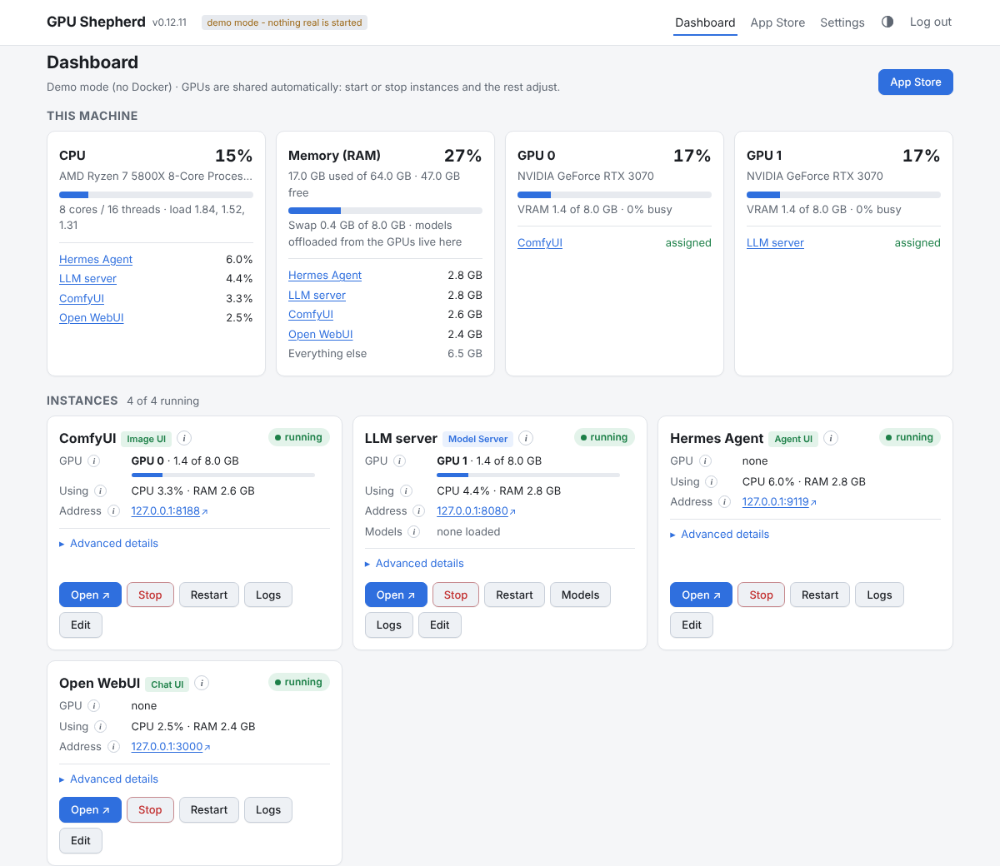
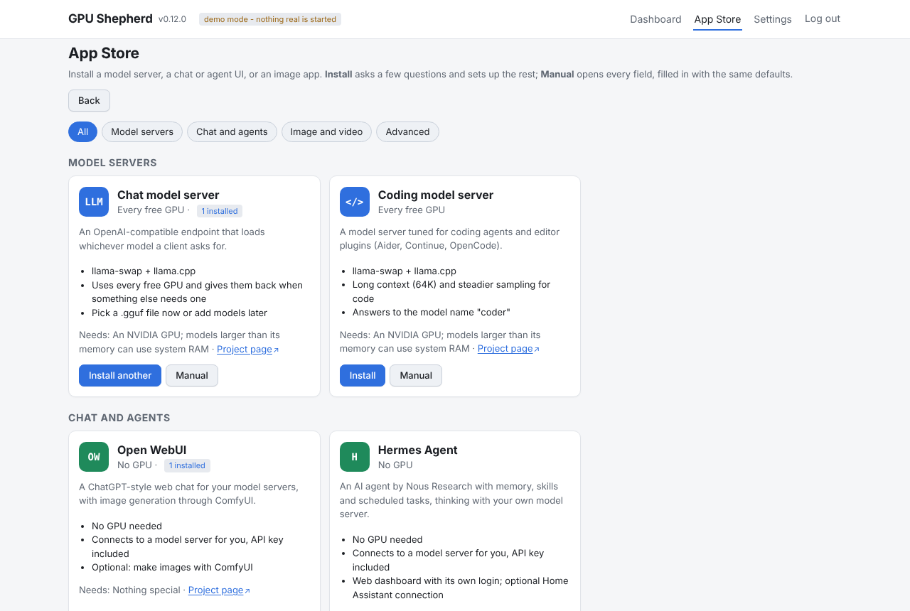
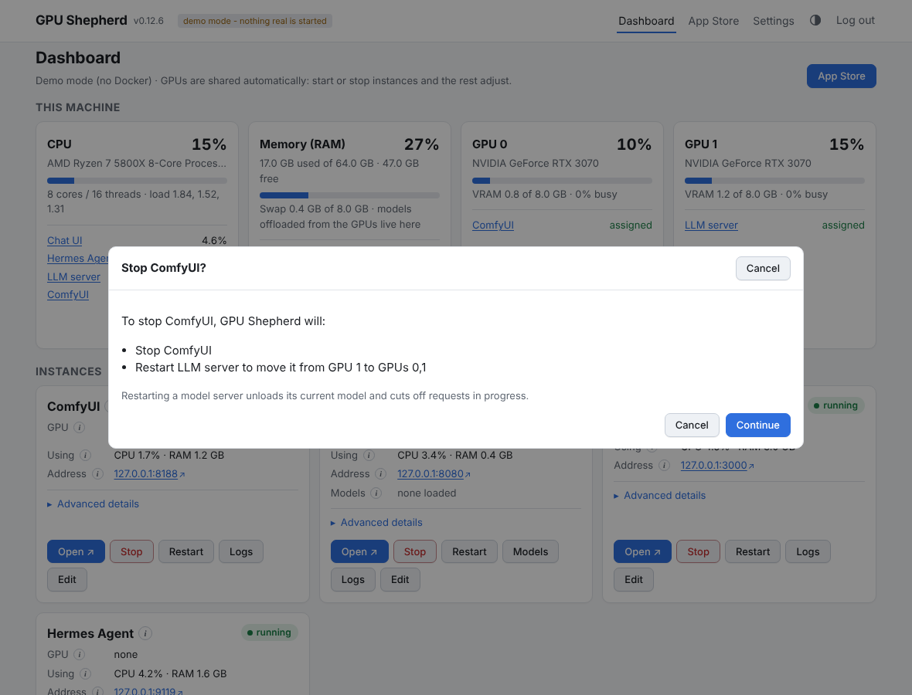
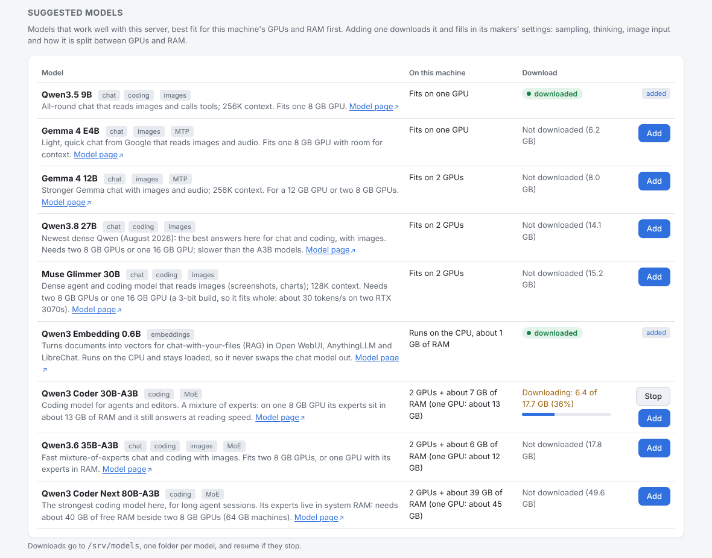
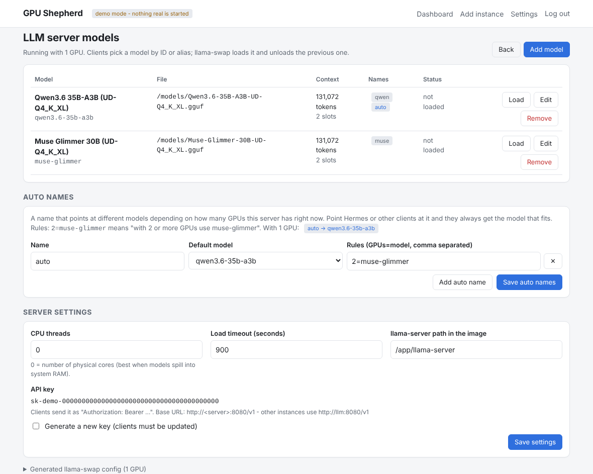
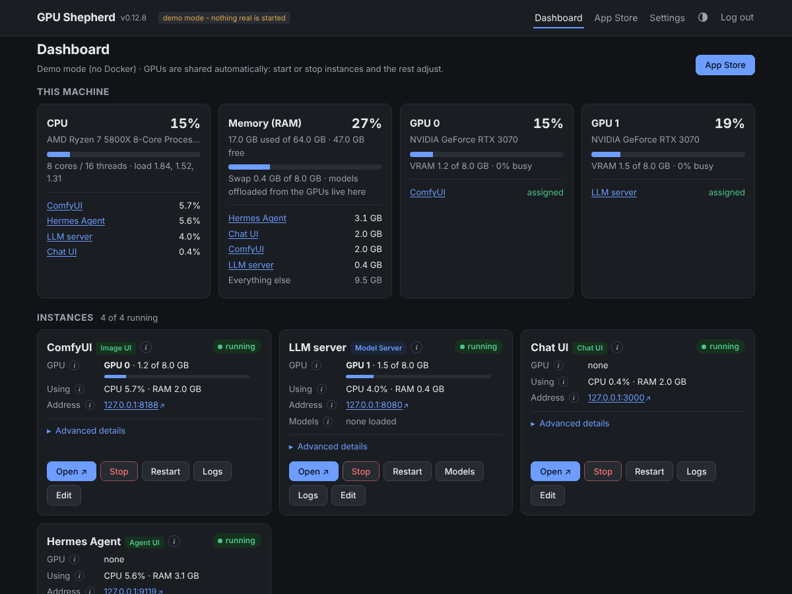
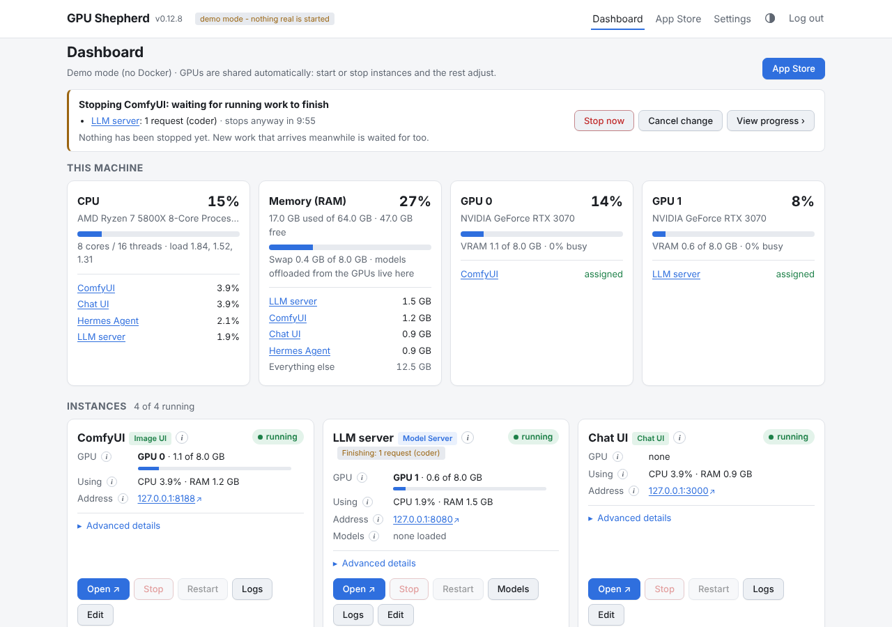

# GPU Shepherd

A small web dashboard that runs your self-hosted AI containers and **shares the GPUs between them
automatically**. Start ComfyUI and your LLM server moves to the other GPU; stop it and the LLM
gets both. Everything is configured from the browser - no compose files to edit.



> Status: early (0.x). It works on one Docker host with NVIDIA GPUs. Expect rough edges and
> breaking changes to the config format before 1.0.

## Why

Homelab GPUs are shared by tools that each assume they own the card: image generators, LLM
servers, speech models. Generic container managers (Dockge, Portainer) can start and stop them,
but they don't know about GPUs, so you end up stopping one thing by hand to start another, or
editing `CUDA_VISIBLE_DEVICES` and restarting. GPU Shepherd treats GPUs as a shared resource:
each instance says what it needs, and starting or stopping anything re-plans who gets which GPU.

## Features

- **App Store**: install an LLM server (with a chat model, a coding model, an embeddings model for
  chatting with your documents, or any mix), Open WebUI,
  LibreChat, AnythingLLM, Hermes Agent or ComfyUI. Apps that need a helper container get it too:
  LibreChat comes with its MongoDB database, which starts and stops with LibreChat.
  **Install** asks only what it can't work out: it picks a free ID and port, mounts the right
  folders, connects chat and agent apps to your model server (or installs one alongside them) and
  decides whether a model needs system RAM. **Manual** opens every field instead, filled in with
  the same defaults, and *Any Docker image* covers apps that aren't listed.

  
- **Instances**: any Docker image - ports, folders, environment, command, autostart - edited in
  forms. One compact card per instance with Start / Stop / Restart / Open / Logs, its name (Open
  WebUI, ComfyUI...) and a tag saying what it is (*Model Server*, *Chat UI*, *Image Server*, *Agent UI*,
  *Database*, or *App* for any other image), its
  state, GPUs and VRAM, CPU and RAM use, web addresses and (for model servers) the loaded model.
  **Advanced details** opens the image, folders, command and the rest. Every detail has a small ⓘ
  next to it: hover, tab to or tap it to see what the value means (GPU rule and priority, ports,
  how much of a model sits in system RAM, and so on).
- **Machine overview**: CPU, RAM and every GPU at a glance, with how much each instance uses.
- **GPU policies** per instance:
  - *Fixed* - always these GPUs (e.g. ComfyUI on GPU 0).
  - *Elastic* - at least N GPUs, grows into every free GPU, shrinks when something else needs one
    (e.g. a llama.cpp server that splits a model across GPUs).
  - *Priority* - who keeps their GPUs when there are not enough to go around.
- **Plans you confirm**: if starting something means moving or stopping something else, you see
  exactly what will happen first.

  
- **Nothing cut off half way**: before a container is stopped, GPU Shepherd waits for the chat
  answer or image it is working on, with *Stop now* and *Cancel change* buttons and a timeout.
- **Model servers** ([llama-swap](https://github.com/mostlygeek/llama-swap)): a model list editor
  that picks .gguf files from disk, load and unload buttons, and **auto names**: one model name,
  like `coder`, that points at the model that fits the GPUs the server has right now.
- **Suggested models**: a short list of current chat, coding and embeddings models (Qwen3.5,
  Qwen3.6, Qwen3.8, Gemma 4, Qwen3 Coder, Qwen3 Embedding), each saying whether it fits this
  machine's GPUs and RAM. One click downloads it in the background and adds it with its makers'
  settings: sampling, thinking on or off, image input, MTP and the GPU / RAM split.

  
- **Model settings**: thinking on or off, MTP (multi-token prediction, up to twice as fast),
  KV cache size, how a model is split over several GPUs, unloading when idle, and an embeddings
  model that stays loaded beside the chat model instead of swapping it out.
- **GPU + system RAM**: keep part of a model (MoE expert layers or whole layers) in system RAM so
  models larger than your GPUs still run, set per GPU count.

  
- **Command line and API**: every button and setting also works from the `gpu-shepherd` command
  (`gpu-shepherd start comfyui`, `apps install`, `models set`...) and a documented JSON API with a
  token, for scripts and Home Assistant. All three run the same code.
- **Light or dark**: follows your device, or pick Light or Dark with the theme button at the top.

  
- **Plain files**: everything is saved as readable YAML - easy to back up, diff, or keep in git.
- **Updates in place**: `update.sh` or a dashboard button, with automatic rollback if an update fails.
- **Small**: one Python process, server-rendered pages with htmx, no JavaScript build step.

## Documentation

- [Instance and model options](docs/advanced.md): every field in the editors and what it does
  (GPU policies, folders, before-stopping checks, GPU/RAM offload, model settings, suggested
  models, auto names).
- [CLI and scripts](docs/cli.md): `install.sh`, `update.sh`, the `gpu-shepherd` command and its
  commands for everything the dashboard does, `download-models.sh` and environment variables.
- [Linux distributions](docs/linux.md): which distros `install.sh` supports and where Docker, the
  NVIDIA Container Toolkit and the driver come from, plus SELinux and Secure Boot notes.
- [Proxmox](docs/proxmox.md): a VM with GPU passthrough, or an LXC container sharing the host's GPU.
- [TrueNAS SCALE](docs/truenas.md): a VM with GPU passthrough, or running it on the host.
- [Unraid](docs/unraid.md): the Nvidia Driver plugin and Docker Compose.
- [JSON API](docs/api.md): `/api/v1`, the API token, and every endpoint with examples.
- [Versions, changelog and updates](docs/updates.md): checking for updates and following one in
  the dashboard, private repositories, and how each merge gets a version. [Changelog](CHANGELOG.md).
- [Presets](gpushepherd/presets/README.md): ready-made sets of instances, and how to make your own.
- [Architecture](docs/architecture.md): how the code fits together.

## Quick start

### Linux: guided install

On Ubuntu, Debian, Fedora, RHEL-family (Rocky, Alma) or Arch with an NVIDIA GPU, and WSL2
(experimental, see [WSL2](docs/linux.md#wsl2)); [supported versions](docs/linux.md):

```bash
git clone https://github.com/TechFreak94/GPU-Shepherd.git gpu-shepherd && cd gpu-shepherd
sudo ./install.sh
```

The installer shows what the machine already has (driver, GPUs, Docker, NVIDIA Container Toolkit,
RAM), asks a few questions with defaults (models folder, port, settings folder), and changes
nothing until you confirm the plan. On the first run it offers a [preset](gpushepherd/presets),
such as `starter` (an LLM server, ComfyUI and Open WebUI for any 8+ GB GPU), and to download its
models. Nothing in a preset starts until you press Start. At the end it prints the address and the
first login.

It is safe to re-run. For scripted installs every question has an option, and `--yes` skips the
rest; see [CLI and scripts](docs/cli.md#installsh).

On Proxmox, TrueNAS SCALE or Unraid, see [Proxmox](docs/proxmox.md), [TrueNAS SCALE](docs/truenas.md) or [Unraid](docs/unraid.md).

RAM: with less than 32 GB, plan on models that fit in GPU memory. 64 GB is recommended for the
largest models (Qwen3 Coder Next is ~49 GB at Q4).

### By hand

Requirements: Linux, Docker with the Compose plugin, the NVIDIA driver and the
[NVIDIA Container Toolkit](https://docs.nvidia.com/datacenter/cloud-native/container-toolkit/latest/install-guide.html).

```bash
git clone https://github.com/TechFreak94/GPU-Shepherd.git gpu-shepherd && cd gpu-shepherd
sudo mkdir -p /opt/gpu-shepherd
cp compose.example.yaml compose.yaml      # read the comments; adjust paths if you like
docker compose up -d --build
docker compose logs gpu-shepherd | grep "First start"   # the generated admin password
```

The data folder must be mounted at the **same path** inside and outside the container (like
Dockge's stacks folder), because GPU Shepherd hands paths in it to Docker for the containers it
creates. To pick model files in the UI, mount your model folders the same way (read-only is fine).

### First login

Open `http://<server>:8090` and log in as `admin` with the password the installer printed (also in
`INITIAL_PASSWORD.txt` in the data folder). Then open the **App Store**.

Lost the password? `sudo docker exec gpu-shepherd gpu-shepherd --reset-password` prints a new one.
It works at once, no restart needed.

### Updating

In the folder you installed from:

```bash
sudo ./update.sh              # show what's new, ask, update and restart GPU Shepherd
sudo ./update.sh --rollback   # go back to the version before the last update
```

Settings, instances and models are kept, and instances keep running while GPU Shepherd restarts.
If an update fails to build or start, it rolls back by itself. The installer can also set up an
**Update** button on the dashboard. Details: [CLI and scripts](docs/cli.md#updatesh).

Click the version number at the top of any page to check for updates, follow an update step by
step, or read the [changelog](CHANGELOG.md): every merged change gets its own version. Installed
from a private repository? Save a GitHub access token in Settings > Private repository, or with
`sudo ./update.sh --set-token <your GitHub user>`. Details:
[Versions, changelog and updates](docs/updates.md).

### Try it without Docker or GPUs

```bash
pip install .
gpu-shepherd --demo --port 8090      # fake GPUs and containers, log in as admin / demo-password
```

## How GPU sharing works

When you start, stop or restart an instance, GPU Shepherd plans the whole machine again:

1. The instance you are starting gets what it needs first.
2. Everyone else is served by priority. Fixed instances need exactly their GPUs; elastic ones
   only say *how many* they need, so they move aside instead of pushing a fixed one out.
3. Leftover GPUs go to elastic instances, highest priority first, up to their maximum.
4. Running instances keep the GPUs they already have when possible, to avoid needless restarts.
5. Anything whose GPUs change is restarted with the new ones; anything that no longer fits is
   stopped. You confirm before either happens, and running work is allowed to finish first.

Containers only ever see the GPUs they were given (Docker device requests), so applications need
no `CUDA_VISIBLE_DEVICES` tricks. Moving an instance re-creates its container; its data lives in
the folders you mounted, so nothing is lost.

Example with two GPUs - ComfyUI *fixed GPU 0, priority 80*, LLM server *elastic 1+, priority 50*:

| Action | ComfyUI | LLM server |
|---|---|---|
| Start the LLM | - | GPUs 0,1 |
| Start ComfyUI | GPU 0 | restarted on GPU 1 |
| Stop ComfyUI | stopped | restarted on GPUs 0,1 |

With a single GPU the same settings make them take turns. A second ComfyUI *fixed GPU 1,
priority 40* would stop the LLM server when started (you are asked first), and starting the LLM
again stops it, since the LLM has the higher priority.

### Letting running work finish

Before a container is stopped, GPU Shepherd asks it whether it is busy and waits until it is idle:
chat answers on llama-swap or llama.cpp, running and queued ComfyUI prompts, or any app with an
HTTP status endpoint. Nothing has been stopped while it waits, so *Cancel change* leaves the
machine as it was and *Stop now* goes ahead at once. After a timeout (10 minutes by default) it
stops the instance anyway or calls the change off, as you choose. GPU Shepherd isn't in the path of
the requests, so work that arrives meanwhile is waited for too.



llama-swap's own model swaps already wait for the model being replaced to finish its requests.
The **Unload** button refuses while a model is still answering. See
[Before stopping](docs/advanced.md#before-stopping) for the settings.

## Coding agents

Coding tools (OpenCode, Aider, Continue, OpenHands, ...) don't need a GPU of their own: point them at
the model server's OpenAI-compatible endpoint and let GPU Shepherd decide what runs there. An auto
name such as `coder` picks the model by how many GPUs the server has. For example, on two 8 GB
GPUs with 64 GB of RAM:

| Model server has | `coder` is | Memory |
|---|---|---|
| 1 GPU (ComfyUI has the other) | Qwen3.6 35B-A3B, 30 expert layers in RAM | ~22 GB file, mostly RAM |
| 2 GPUs | Qwen3 Coder Next 80B-A3B, 38 expert layers in RAM | ~49 GB file, ~40 GB of it in RAM |

```bash
export OPENAI_API_BASE=http://<server>:8080/v1
export OPENAI_API_KEY=<the model server's API key, shown on its Models page>
aider --model openai/coder
```

The expert-layer numbers are starting points for 8 GB cards: if a model fails to load, raise them;
if GPU memory is left over, lower them for speed. See
[GPU and system RAM](docs/advanced.md#gpu-and-system-ram). Models added from the
[suggested models](docs/advanced.md#suggested-models) get these numbers worked out for your GPUs.

On one 8 GB GPU, a model that fits it whole (Qwen3.5 9B) answers at roughly 50-70 tokens a second;
a 30B-A3B coding model with its experts in RAM at roughly 15-30, with clearly better code. Both are
in the suggested models.

## Configuration files

```
/opt/gpu-shepherd/
  settings.yaml          login, Docker network, publish address      (mode 600)
  instances/<id>.yaml    one per instance
  catalogs/<id>.yaml     model list + API key per model server        (mode 600)
  generated/<id>/        files rendered for containers - do not edit
  update/                update status, log and settings backups
```

You can edit the YAML by hand; GPU Shepherd re-reads it on every page load and shows a warning
for files it cannot parse. Saving from the UI rewrites the file (comments are not kept) and leaves
the previous version next to it as `<file>.prev`. Every key is described in
[Instance and model options](docs/advanced.md).

## Security

GPU Shepherd controls Docker through its socket, which is root-equivalent on the host. It has a
login (scrypt-hashed password, `SameSite=strict` session cookie), refuses state-changing requests
that don't come from its own pages, and sends a strict Content-Security-Policy. Still: keep it on
a trusted network or behind a VPN/reverse proxy with authentication. Do not expose it to the
internet. The apps it starts (ComfyUI, for one) may have no login of their own.

## Development

```bash
pip install -e ".[dev]"
pytest
gpu-shepherd --demo                      # fake GPUs/containers, admin / demo-password
```

See [docs/architecture.md](docs/architecture.md) and [CONTRIBUTING.md](CONTRIBUTING.md).

## Roadmap

- More model-server connectors: Ollama (for Home Assistant's own Assist), vLLM.
- Shared GPUs: let several small instances share one GPU with memory budgets.
- Import an existing `docker compose` project as instances.
- Scheduled actions (e.g. give the LLM every GPU overnight).
- Live log streaming, Prometheus metrics, multiple users.
- AMD (ROCm) and multi-host support.

## License

Apache-2.0 - see [LICENSE](LICENSE). Bundles [htmx](https://htmx.org) (Zero-Clause BSD,
`gpushepherd/static/htmx.LICENSE.txt`).
