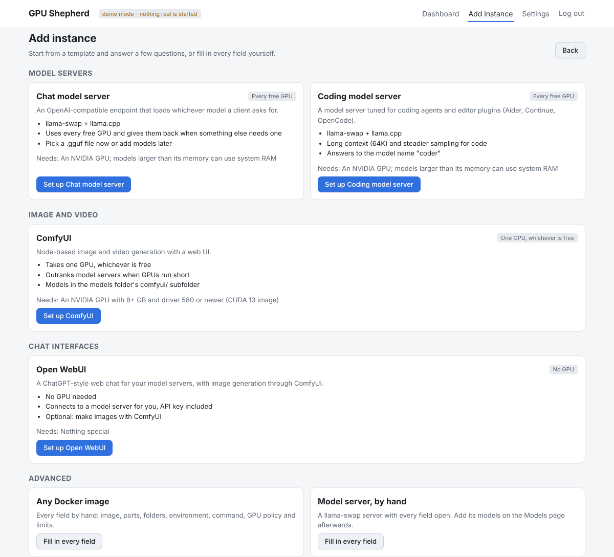

# GPU Shepherd

A small web dashboard that runs your self-hosted AI containers and **shares the GPUs between them
automatically**. Start ComfyUI and your LLM server moves to the other GPU; stop it and the LLM
gets both. Everything is configured from the browser - no compose files to edit.


> Status: early (0.1). It works on one Docker host with NVIDIA GPUs. Expect rough edges and
> breaking changes to the config format before 1.0.

## Why

Homelab GPUs are shared by tools that each assume they own the card: image generators, LLM
servers, speech models. Generic container managers (Dockge, Portainer) can start and stop them,
but they don't know about GPUs, so you end up stopping one thing by hand to start another, or
editing `CUDA_VISIBLE_DEVICES` and restarting. GPU Shepherd treats GPUs as a shared resource:
each instance says what it needs, and starting or stopping anything re-plans who gets which GPU.

## Features

- **Guided setup**: *Add instance* starts from a template - a chat or coding model server
  (llama-swap), ComfyUI or Open WebUI - and asks only what it can't work out: name, port, GPUs,
  folders and, for model servers, a first .gguf file. It picks a free ID and port, mounts the
  right folders, connects Open WebUI to your model server (API key included) and decides from the
  file size whether a model needs system RAM. *Customize every field* opens the full form with the
  answers filled in, and *Any Docker image* skips the questions altogether.

  
- **Instances**: any Docker image - ports, folders, environment, command, autostart - edited in
  forms. One compact card per instance with Start / Stop / Restart / Open / Logs, showing its
  state, GPUs and VRAM, CPU and RAM use, web addresses and (for model servers) the loaded model.
  Hover, tab to or tap a label (or the ⓘ next to the name) for the details behind it: the GPU rule
  and priority, ports, image, folders, and how much of a model sits in system RAM.
- **Machine overview**: CPU, RAM and every GPU at a glance, with how much each instance uses.
- **GPU policies** per instance:
  - *Fixed* - always these GPUs (e.g. ComfyUI on GPU 0).
  - *Elastic* - at least N GPUs, grows into every free GPU, shrinks when something else needs one
    (e.g. a llama.cpp server that splits a model across GPUs).
  - *Priority* - who keeps their GPUs when there are not enough to go around.
- **Plans you confirm**: if starting something means moving or stopping something else, you see
  exactly what will happen first.

  
- **Model servers** ([llama-swap](https://github.com/mostlygeek/llama-swap)): a model catalogue
  editor (pick .gguf files from disk, context, sampling, KV cache, vision projector), load and
  unload buttons, and **auto names** - a model name like `auto` that points at different models
  depending on how many GPUs the server currently has. Point an agent at `auto` and it always gets
  the model that fits.
- **GPU + system RAM**: per model, keep part of it in system RAM (MoE expert layers or whole
  layers) so models larger than your GPUs still run. Set it per GPU count: e.g. 30 expert layers
  in RAM when the server has one GPU, 14 when it has two.

  
- **Plain files**: everything you change is saved as readable YAML - easy to back up, diff, or
  keep in git.
- **Small**: one Python process, server-rendered pages with htmx, no JavaScript build step.

## Quick start

### Ubuntu: guided install

On Ubuntu 26.04 (24.04 works too) with an NVIDIA GPU:

```bash
git clone <this repo> gpu-shepherd && cd gpu-shepherd
sudo ./install.sh
```

The installer first shows what the machine already has (driver, GPUs, Docker, NVIDIA Container
Toolkit, RAM). Then it asks a few questions, each with a default you can accept with Enter: where
your .gguf model files are, which port to use, and where to keep settings. If the NVIDIA driver is
missing it offers to install it (that needs a reboot; run the installer again afterwards). On the
first run it offers a [preset](gpushepherd/presets): a ready-made set of instances to start from,
such as `starter` (an LLM server, ComfyUI with SDXL and Open WebUI for any 8+ GB GPU), a preset of
your own, or none. The preset is filled in with your folders and fresh API keys and passwords, and nothing in
it starts until you press Start. It also offers to download the preset's models (resumable) once
everything else is done. Finally it shows the plan, and
nothing is installed or changed until you confirm. Then it installs what is missing, checks that a
container can see the GPUs, adds you to the `docker` group (so `docker` works without sudo from your
next login; `--no-docker-group` skips this), starts GPU Shepherd and prints the address, the first
login, and the preset's addresses. It is safe to re-run: it only does what is still missing, and keeps an existing
`compose.yaml`.

For scripted or advanced installs, every question has a flag, and `--yes` skips the rest:

```bash
sudo ./install.sh --yes --models-dir /srv/models --port 8090 --data-dir /opt/gpu-shepherd
```

`./install.sh --help` lists them all (`--preset`, `--list-presets`, `--download-models`, `--install-driver`, `--skip-deps`, `--no-start`, ...).

RAM: with less than 32 GB installed, models have to fit in GPU memory, because keeping part of a
model in system RAM needs room for it plus the OS and your other containers. 64 GB is recommended
for the largest models (Qwen3 Coder Next is ~49 GB at Q4).

### By hand

Requirements: Linux, Docker with the Compose plugin, NVIDIA driver and the
[NVIDIA Container Toolkit](https://docs.nvidia.com/datacenter/cloud-native/container-toolkit/latest/install-guide.html).

```bash
git clone <this repo> gpu-shepherd && cd gpu-shepherd
sudo mkdir -p /opt/gpu-shepherd
cp compose.example.yaml compose.yaml      # read the comments; adjust paths if you like
docker compose up -d --build
docker compose logs gpu-shepherd | grep "First start"   # the generated admin password
```

Open `http://<server>:8090`, log in as `admin`, then **Add instance** or **Add model server**.
Lost the password? `sudo docker exec gpu-shepherd gpu-shepherd --reset-password` prints a new one
(also saved in `INITIAL_PASSWORD.txt` in the data folder); it works at once, no restart needed.

The data folder must be mounted at the **same path** inside and outside the container (like
Dockge's stacks folder), because GPU Shepherd hands paths in it to Docker for the containers it
creates. To pick model files in the UI, mount your model folders the same way (read-only is fine).

### Updating

No need to clone again. In the folder you installed from:

```bash
sudo ./update.sh            # shows what's new, asks, downloads it, rebuilds and restarts GPU Shepherd
sudo ./update.sh --check    # only look (exit status 10 means an update is available)
sudo ./update.sh --rollback # something wrong? go back to the version before the last update
```

Your settings, instances, model lists and password live in the data folder and are kept, and so
is your `compose.yaml`. Instances keep running while GPU Shepherd restarts. Updates only move
forward along the branch you cloned: if you edited files in the clone, the update stops and lists
them, and `--stash` sets them aside and puts them back afterwards. `./install.sh --update` does
the same as `./update.sh`.

**Updating from the dashboard.** GPU Shepherd runs in a container and can't rebuild itself, so
this is done by a small systemd service on the host, which the guided installer offers (or turn it
on any time with `sudo ./update.sh --enable-dashboard-updates`; `--disable-dashboard-updates`
removes it). It checks for updates once a day; the dashboard then shows **Update available** with
the list of changes and an **Update** button, and Settings > Updates has **Check now**. The two
sides only talk through files in `<data folder>/update/`, so the container never needs git, your
GitHub credentials or more access to the host than it already has. Without the service, the
dashboard still shows what is running and tells you which command to run.

Installed before `update.sh` existed? Run `git pull && sudo ./update.sh --rebuild` once.

**If an update goes wrong.** Before every update, `update.sh` keeps the image that is running
(as `gpu-shepherd:previous`) and backs up `settings.yaml`, `instances/` and `catalogs/` to
`<data folder>/update/backups/` (the newest 10 are kept). If the new version fails to build, or
builds but doesn't answer within 90 seconds, it goes back by itself: the clone returns to the old
commit, the saved image is started again (no rebuild or network needed) and the settings from just
before are restored. The dashboard then says the update failed and that it went back, with the log.
Everything runs on the host, so this works even when the dashboard is down. By hand:

```bash
sudo ./update.sh --rollback          # back to the version before the last update (saved image)
sudo ./update.sh --restore-settings  # settings from just before it (current ones -> *.before-restore)
sudo docker compose logs gpu-shepherd   # why it failed
```

Updates never touch your models or app data, and never delete the data folder. As a last resort,
`git -C <clone> log` lists every version; `git -C <clone> reset --keep <commit>` and
`sudo ./update.sh --rebuild` run any of them.

### Try it without Docker or GPUs

```bash
pip install .
gpu-shepherd --demo --port 8090      # fake GPUs and containers, log in as admin / demo-password
```

The demo starts with the [`starter` preset](gpushepherd/presets/starter); `--demo-preset NAME` picks
another one from `gpushepherd/presets`.

## How GPU sharing works

When you start, stop or restart an instance, GPU Shepherd plans the whole machine again:

1. The instance you are starting gets what it needs first.
2. Everyone else is served by priority. Fixed instances need exactly their GPUs; elastic ones
   only say *how many* they need, so they move aside instead of pushing a fixed one out.
3. Leftover GPUs go to elastic instances, highest priority first, up to their maximum.
4. Running instances keep the GPUs they already have when possible, to avoid needless restarts.
5. Anything whose GPUs change is restarted with the new ones; anything that no longer fits is
   stopped. You confirm before either happens.

Containers only ever see the GPUs they were given (Docker device requests), so applications need
no `CUDA_VISIBLE_DEVICES` tricks. Moving an instance means re-creating its container; its data
lives in the folders you mounted, so nothing is lost.

Example with two GPUs - ComfyUI *fixed GPU 0, priority 80*, LLM server *elastic 1+, priority 50*:

| Action | ComfyUI | LLM server |
|---|---|---|
| Start the LLM | - | GPUs 0,1 |
| Start ComfyUI | GPU 0 | restarted on GPU 1 |
| Stop ComfyUI | stopped | restarted on GPUs 0,1 |

With a single GPU the same settings make them take turns.

A second ComfyUI *fixed GPU 1, priority 40* would give two image jobs at once: starting it stops the
LLM server (you are asked first), and starting the LLM again stops it, since the LLM has the higher
priority.

## Coding agents

Coding tools (OpenCode, Aider, Continue, OpenHands, ...) don't need a GPU of their own: point them at
the model server's OpenAI-compatible endpoint and let GPU Shepherd decide what runs there. An auto
name on the Models page, say `coder`, picks the model by how many GPUs the server has. For example,
on two 8 GB GPUs with 64 GB of RAM:

| Model server has | `coder` is | Memory |
|---|---|---|
| 1 GPU (ComfyUI has the other) | Qwen3.6 35B-A3B, 30 expert layers in RAM | ~22 GB file, mostly RAM |
| 2 GPUs | Qwen3 Coder Next 80B-A3B, 38 expert layers in RAM | ~49 GB file, ~40 GB of it in RAM |

So 64 GB of system RAM is enough for the larger one. For example with OpenCode or Aider:

```bash
export OPENAI_API_BASE=http://<server>:8080/v1
export OPENAI_API_KEY=<the model server's API key, shown on its Models page>
aider --model openai/coder
```

The expert-layer numbers are starting points for 8 GB cards: if a model fails to load, raise them on
its edit page (GPU and system RAM); if there is GPU memory left over, lower them for more speed.

## Configuration files

```
/opt/gpu-shepherd/
  settings.yaml          login, Docker network, publish address      (mode 600)
  instances/<id>.yaml    one per instance
  catalogs/<id>.yaml     model catalogue + API key per model server  (mode 600)
  generated/<id>/        files rendered for containers - do not edit
```

You can edit the YAML by hand; GPU Shepherd re-reads it on every page load and shows a warning
for files it cannot parse. Saving from the UI rewrites the file (comments are not kept) and leaves
the previous version next to it as `<file>.prev`.

## Security

GPU Shepherd controls Docker through its socket, which is root-equivalent on the host. It has a
login (scrypt-hashed password, `SameSite=strict` session cookie), refuses state-changing requests
that don't come from its own pages, and sends a strict Content-Security-Policy. Still: keep it on
a trusted network or behind a VPN/reverse proxy with authentication. Do not expose it to the
internet. The apps it starts (ComfyUI, for one) may have no login of their own.

## Development

```bash
pip install -e ".[dev]"
pytest                                   # planner, config, llama-swap rendering, UI flows, Docker payloads
gpu-shepherd --demo                      # fake GPUs/containers, admin / demo-password
```

See [docs/architecture.md](docs/architecture.md) and [CONTRIBUTING.md](CONTRIBUTING.md).

## Roadmap

- More model-server connectors: Ollama, vLLM, SGLang.
- Shared GPUs: let several small instances share one GPU with memory budgets.
- Import an existing `docker compose` project as instances.
- Scheduled actions (e.g. give the LLM every GPU overnight).
- Live log streaming, Prometheus metrics, multiple users.
- AMD (ROCm) and multi-host support.

## License

Apache-2.0 - see [LICENSE](LICENSE). Bundles [htmx](https://htmx.org) (Zero-Clause BSD,
`gpushepherd/static/htmx.LICENSE.txt`).
