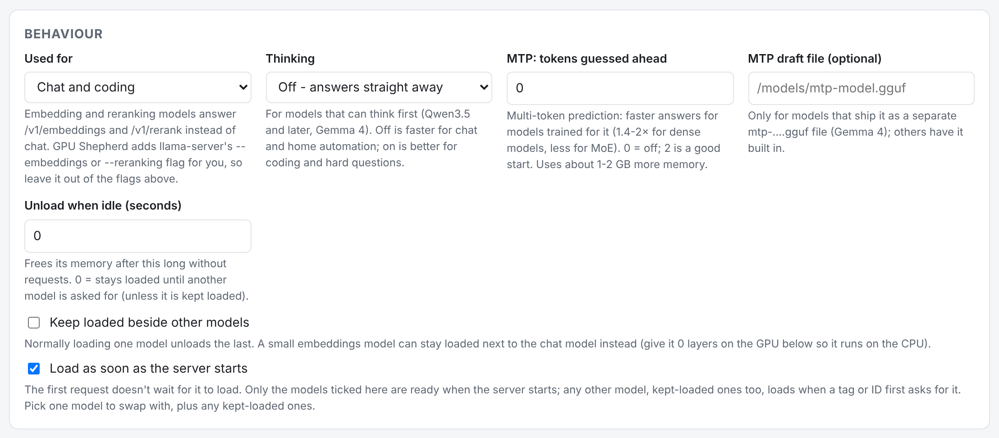
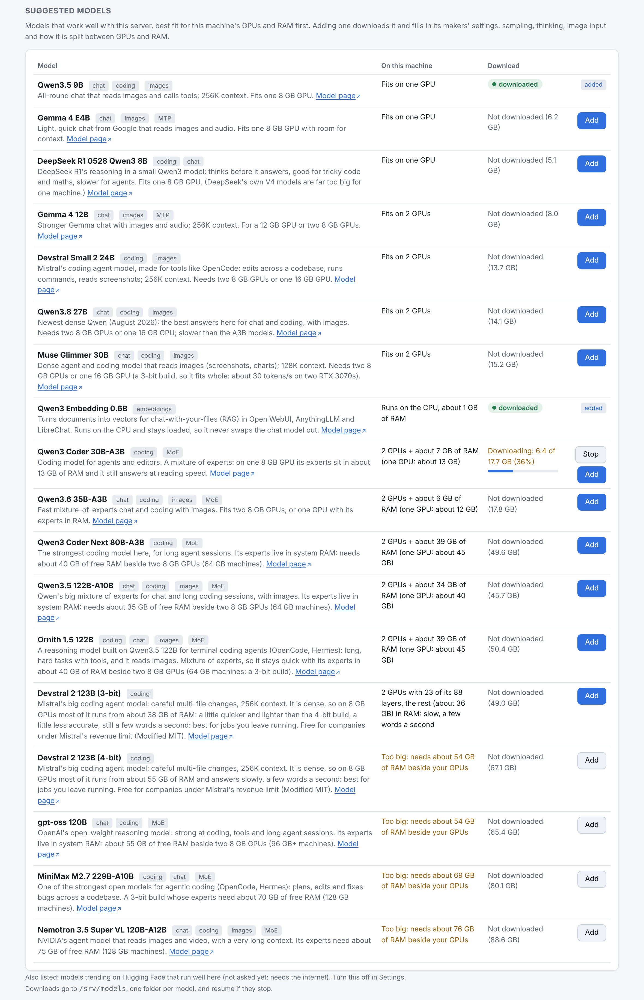
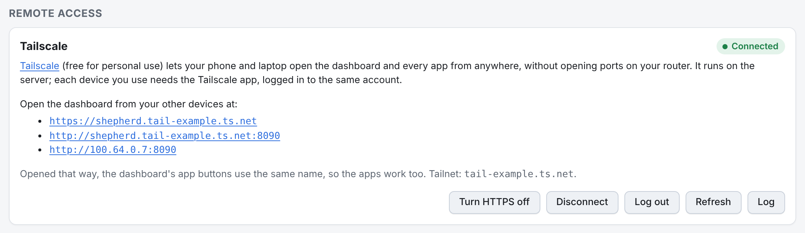
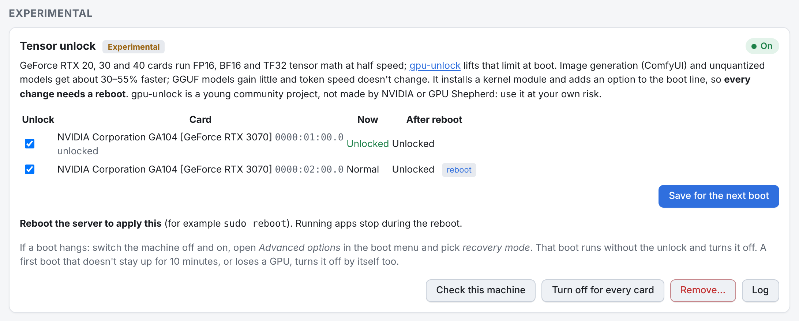
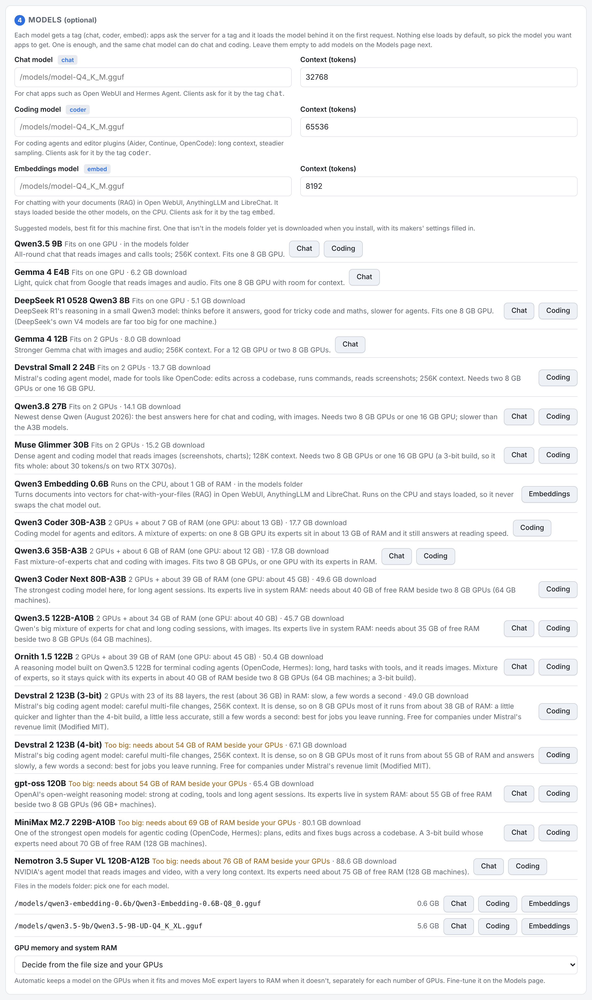
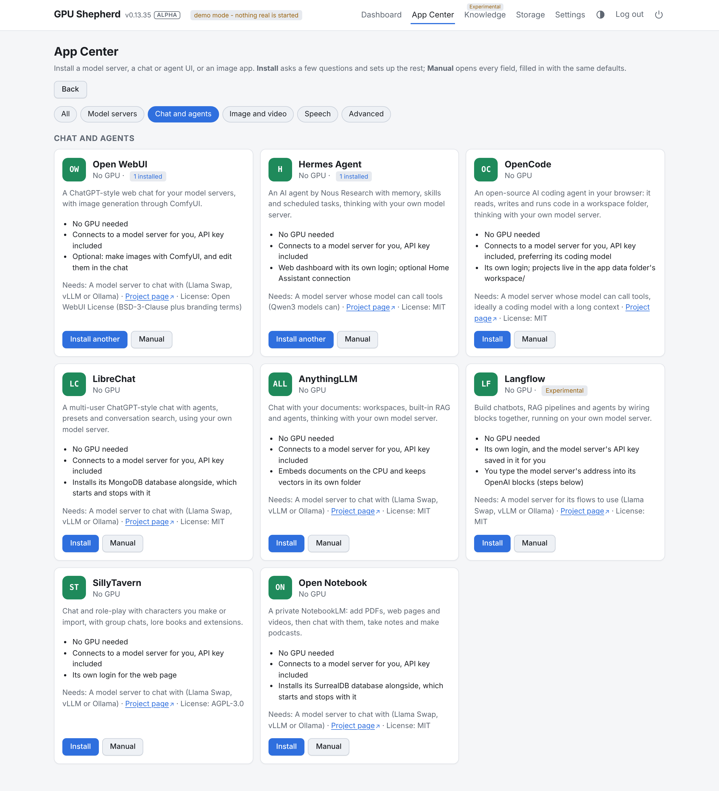
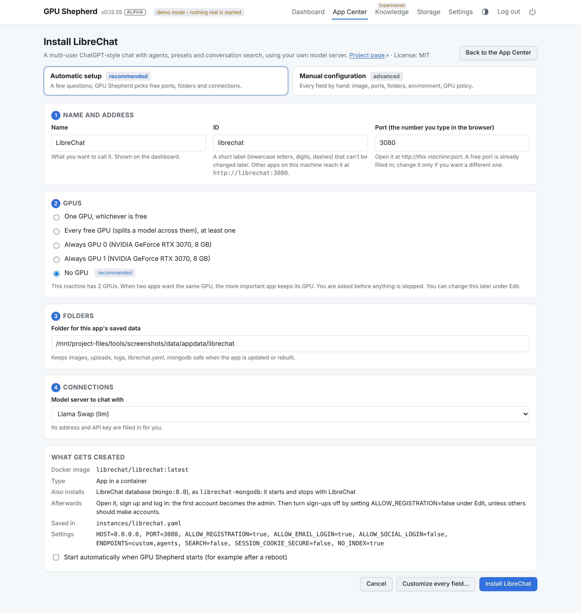
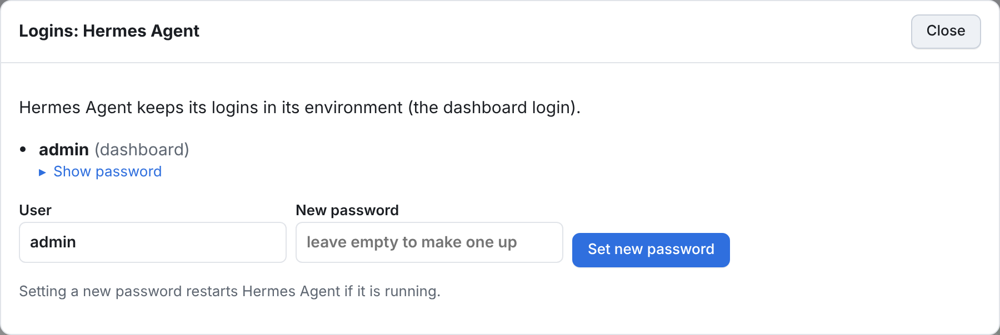
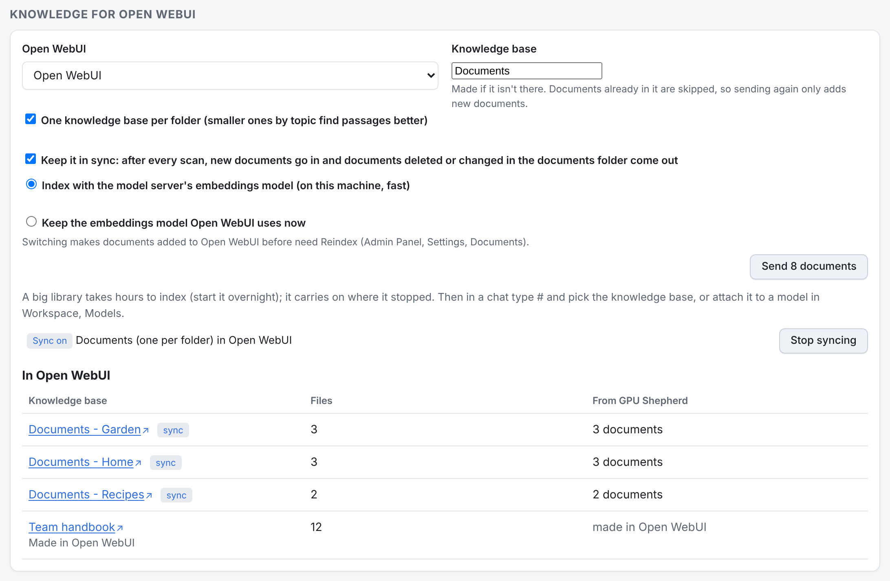

# Instance and model options

Every option you can set in the editors, what it does, and the key it is saved under. The App
Center's automatic setup fills most of these in for you; open an instance's **Edit** page, or
choose *Manual configuration* (or *Customize every field*) while installing one, to change them.

Instances are saved to `instances/<id>.yaml` in the data folder, model servers' model lists to
`catalogs/<id>.yaml`. Changes take effect the next time the instance starts or restarts.

Every option can also be set without the browser, by its YAML key: `gpu-shepherd set <id>
gpu.mode=elastic`, `gpu-shepherd models set <server> <model> ctx_size=65536` and so on (see
[Commands](cli.md#commands)), or through the [JSON API](api.md).

- [Instances](#instances): basics, GPUs, network and storage, command, behaviour, before stopping
- [Model servers](#model-servers): models, model behaviour, GPU and system RAM, suggested models,
  auto names, server settings
- [Settings](#settings), including [Tensor unlock](#tensor-unlock) (experimental)
- [Storage and trash](#storage-and-trash)
- [What App Center apps fill in](#what-app-center-apps-fill-in)

## Instances

### Basics

| Field | YAML | What it does |
|---|---|---|
| Name | `name` | Shown on the dashboard. A name that only repeats the app's tag, like `Chat UI` (what older versions called Open WebUI), shows as the app's name (*Open WebUI*); saving the instance writes that name to its file. |
| ID | `id` | Lowercase letters, digits and dashes, at most 40. Names the file and the container (`shepherd-<id>`), and is the host name other instances use to reach it (`http://<id>:<port>`). Can't be changed after creation. |
| Image | `image` | Any Docker image, e.g. `ghcr.io/org/app:tag`. Pulled when the instance starts. |
| Description | `description` | Free text. |
| - | `kind` | `container` for any app, `llama-swap` for a model server (adds the Models page). Set by the app or the *Model server, by hand* link. |
| - | `app` | The App Center app it was installed from (`llm-server`, `hermes`...), for the App Center's *installed* count and the tag on its dashboard card (*Model Server*, *Chat UI*, *Image UI*, *Agent UI*, *Database*; *App* for anything else). Changing it needs no restart. |

### GPUs

| Field | YAML | What it does |
|---|---|---|
| Kind of GPU | `gpu.vendor` | `nvidia` (CUDA, the default) or `amd` (Vulkan, or ROCm). Each kind is planned on its own: an app only gets GPUs of its kind. AMD support is experimental and untried on real cards. |
| GPU use | `gpu.mode` | `none`: no GPU. `fixed`: always exactly the GPUs listed. `elastic`: needs at least *Minimum GPUs*, takes every free GPU up to *Maximum GPUs* (a Llama Swap server: only as many as its models can use), and gives them back when something else needs one. |
| Use GPUs / Preferred GPUs | `gpu.gpus` | Fixed: the GPUs it always uses (by `nvidia-smi` index; AMD GPUs are numbered from 100, shown as *AMD GPU 0*, *AMD GPU 1*...). Elastic: optional, the GPUs it takes first when it has a choice. |
| Minimum GPUs | `gpu.min_gpus` | Elastic only. Fewer than this and it can't start. |
| Maximum GPUs | `gpu.max_gpus` | Elastic only. `0` = no limit. `1` makes "one GPU, whichever is free". |
| Priority (0-100) | `gpu.priority` | When there aren't enough GPUs, higher priority keeps theirs and lower ones are moved or stopped (after you confirm). The instance you are starting always wins. |
| Run on the CPU when no GPU is free | `gpu.cpu_fallback` | Elastic only. Instead of being stopped when it loses its GPUs, it keeps running without one (a Llama Swap server runs its models on the CPU, slower) and moves back onto a GPU when one is free. On by default for Llama Swap servers. |
| Video memory budget (GB) | `gpu.vram_gb` | Elastic with a maximum of 1 only. Apps with a budget share a GPU, as many as fit in its memory (a Llama Swap server also fits its models into the budget). `0` = a GPU of its own. |

Rule of thumb: apps that use one GPU (ComfyUI, speech models) are fixed or elastic with a maximum
of 1; Llama Swap servers that split a model across GPUs are elastic with no maximum. The
[README](../README.md#how-gpu-sharing-works) walks through how a plan is made. At boot, Llama Swap
servers get their GPUs first, so chat works after a reboot even when one GPU can't hold every app.

AMD GPUs reach a container as their `/dev/dri` render nodes, which Vulkan needs, so a built-in graphics
chip is left alone. A ROCm image also needs `/dev/kfd`: add it under *Devices* (`devices`, host device
paths passed in as they are, in the editor's Advanced section). Don't list GPUs there; pick them under GPUs.

A container only sees the GPUs it was given. When its GPUs change it is re-created, so anything it
needs to keep must be in a mounted folder.

### Network and storage

| Field | YAML | What it does |
|---|---|---|
| Ports | `ports` | `HOST:CONTAINER`, one per line, `/udp` for UDP. Published on the address from Settings. A host port can belong to one instance only. |
| Folders | `volumes` | `/host/path:/container/path`, one per line, `:ro` for read-only. The host folder must exist. Model servers expect their models at `/models`. |

Every instance also joins the Docker network from Settings (`gpushepherd` by default), so
instances talk to each other by ID without publishing ports.

### Command and environment

| Field | YAML | What it does |
|---|---|---|
| Command | `command` | Replaces the image's default command. Quoted like a shell line; saved as a list. Empty = the image's default. |
| Environment | `env` | `NAME=value`, one per line. |

For model servers GPU Shepherd adds the llama-swap config and the API key itself; don't set a
command there.

### Behaviour

| Field | YAML | What it does |
|---|---|---|
| Start automatically | `autostart` | Started when GPU Shepherd starts, if the GPUs allow it. Instances installed from the App Center or a preset start with this off. |
| "Open" button port | `open_port` | Host port the Open button links to. Empty = the first port. |
| "Open" button path | `open_path` | Path after the address, e.g. `/ui`. |
| Starts with | `requires` | IDs of instances it needs, such as its database. Starting it starts them first (and autostart brings them up too); stopping it stops them too (after it), unless another running instance requires them. Stopping one of them by itself leaves the app running. Starting fails if one of them doesn't exist. Changing it needs no restart. |
| Shared memory | `shm_size` | Size of `/dev/shm`, e.g. `1g`. PyTorch apps with several workers often need more than Docker's 64 MB. |
| Run as user | `user` | `UID:GID` inside the container, e.g. `1000:1000`, so files it writes to your folders are yours. |
| Memory limit | `memory_limit` | Caps the container's RAM, e.g. `16g`. Empty = no limit. |
| Install new versions automatically | `auto_update` | Off by default. GPU Shepherd [looks for new releases of the app's image](#app-image-updates); with this on it installs one by itself (waiting for running work), otherwise the card offers an **Update** button. |

The last three are under *Advanced* in the editor.

### Before stopping

When a GPU swap, a restart or Stop would stop a running instance, GPU Shepherd first waits for the
work it is doing to finish, so a chat answer or an image isn't cut off half way. While it waits,
nothing has been stopped yet: the dashboard shows what it is waiting for and lets you go ahead at
once or call the change off.

| Field | YAML | What it does |
|---|---|---|
| Wait for running work | `drain.check` | How it tells whether the instance is busy (below). |
| Wait at most | `drain.timeout` | Seconds, default `600`. `0` = don't wait. Long video or batch jobs may need more. |
| If it is still busy then | `drain.on_timeout` | `stop`: stop it anyway. `cancel`: call the whole change off and leave everything as it was. |
| Container port to ask | `drain.port` | Which port inside the container to ask. Default: 8080 for llama-swap and llama.cpp, 8188 for ComfyUI, else the first port. |
| Path | `drain.path` | Custom check only: the URL path to ask, starting with `/`. |
| JSON field | `drain.key` | Custom check only: where the amount of work is in the answer. Dots go deeper (`queue.running`); empty = the whole answer. |

The checks:

| `check` | Busy means |
|---|---|
| `auto` (default) | Picks one of the checks below: `llama-swap` for model servers and llama-swap images, `comfyui` for images with "comfy" in the name, `llama-server` for llama.cpp images. Anything else isn't waited for. |
| `llama-swap` | llama-swap is answering requests (from its `/api/events`; on older versions, each loaded model's `/slots`). |
| `llama-server` | a llama.cpp server `/slots` entry is processing. |
| `comfyui` | prompts are running or queued (`/queue`). |
| `http` | `GET <path>` answers with a non-zero number, a non-empty list, or `true` at `<key>`. Use this for any app with a status endpoint. |
| `none` | never wait. |

It asks every 2 seconds. A check that gets no answer doesn't hold the change up: it is logged and
the stop goes ahead. GPU Shepherd isn't in the path of the requests, so it can't turn new work away
while it waits; work that arrives meanwhile is waited for too, up to the same timeout.

Changing these settings never asks for a restart.

Example, for an app whose `/api/status` answers `{"jobs": {"active": 2}}`:

```yaml
drain:
  check: http
  port: 7860
  path: /api/status
  key: jobs.active
  timeout: 1800
  on_timeout: cancel
```

## Model servers

A model server is a [llama-swap](https://github.com/mostlygeek/llama-swap) instance. It serves an
OpenAI-compatible API at `http://<server>:<port>/v1` and loads whichever model a client asks for,
unloading the previous one. Its **Models** page holds the model list. GPU Shepherd writes the
llama-swap config from that list, for the number of GPUs the server has each time it starts.

### Models

| Field | YAML (`models[]`) | What it does |
|---|---|---|
| Path inside the container | `file` | The .gguf file, e.g. `/models/model-Q4_K_M.gguf`. For split models, the first part (`…-00001-of-0000N.gguf`). The editor lists the files it can see. |
| Model ID | `id` | The name clients ask for. Letters, digits, `.`, `_`, `:` and `-`. |
| Display name, Description | `name`, `description` | Shown in the UI. |
| Other names | `aliases` | More names for the same model. Each name can be used once per server. |
| Context | `ctx_size` | Tokens, shared by all slots (`--ctx-size`). |
| Parallel slots | `parallel` | Requests served at once; each gets context ÷ slots (`--parallel`). |
| KV cache | `kv_cache` | Memory for the context (`--cache-type-k/-v`): `f16` (default), `bf16` (same size; try it if a model's answers turn to gibberish), `q8_0` (half the memory, a good choice from 32K tokens up), `q5_1` (a third) or `q4_0` (smallest). |
| Sampling flags | `sampling` | e.g. `--temp 0.6 --top-p 0.95 --top-k 20`. Use the model card's values. |
| Extra llama-server flags | `extra_args` | Anything else for `llama-server`, e.g. `--no-mmap`. |
| Vision projector | `mmproj` | For vision models, the `mmproj` file. It is kept in system RAM so the GPUs hold more of the model. |

Every model is started with `--jinja` (the model's own chat template).

### Model behaviour



| Field | YAML (`models[]`) | What it does |
|---|---|---|
| Used for | `role` | `chat` (default: chat and coding), `embed` (answers `/v1/embeddings`, for chatting with documents; `--embeddings` is added for you) or `rerank` (answers `/v1/rerank`; `--reranking` is added for you). |
| Thinking | `thinking` | `auto` (the model's default), `on` or `off`, for models that can reason before answering (Qwen3.5 and later, Gemma 4): `--chat-template-kwargs '{"enable_thinking": …}'`. Off answers straight away, which suits chat and home automation; on is better for coding and hard questions. Use the matching sampling: Qwen's makers give different values for each. |
| MTP: tokens guessed ahead | `mtp` | Multi-token prediction: the model guesses this many tokens ahead and checks them in one step (`--spec-type draft-mtp --spec-draft-n-max N`). 1.4-2× faster for dense models trained for it, less for MoE models; costs about 1-2 GB more memory. `0` = off, `2` is a good start, at most 6. Needs a model with MTP layers (Unsloth's `…-MTP-GGUF` repositories, Gemma 4, Qwen3.8). |
| MTP draft file | `mtp_draft` | For models that ship their MTP layers as a separate `mtp-….gguf` file (Gemma 4): its path (`--model-draft`). Empty when they are built into the model file. |
| Unload when idle | `ttl` | Seconds without requests before llama-swap unloads the model, freeing its memory (llama-swap's `ttl`). `0` = stays loaded until another model is asked for. The server keeps its GPUs either way; only stopping it gives them back. |
| Keep loaded beside other models | `keep_loaded` | Normally loading one model unloads the last. Models with this set go in a llama-swap group of their own that stays loaded (`groups`, `persistent`), so a small embeddings model can answer next to the chat model instead of swapping it out. Give it `gpu_layers: 0` so it runs on the CPU and takes no GPU memory. |
| Load as soon as the server starts | `preload` | Loads the model when the server starts (llama-swap's `hooks.on_startup.preload`), so the first request doesn't wait. Pick one model that swaps, plus any kept-loaded ones. The suggested embeddings model has it ticked, so chat apps can embed documents straight away. |

### GPU and system RAM

For models bigger than the GPUs' memory, part of the model can stay in system RAM. A server can
have a different number of GPUs each time it starts, so this is set per GPU count (`offload`):

| Field | YAML (`offload[]`) | llama.cpp flag |
|---|---|---|
| Server has N GPUs | `min_gpus` | - |
| Layers on GPU | `gpu_layers` | `--n-gpu-layers`; empty = llama.cpp's default |
| MoE expert layers in RAM | `cpu_moe` | `--n-cpu-moe`; `999` = all of them |

A row covers its GPU count and every larger count until the next row. With no row that applies,
the whole model goes on the GPUs.

- **Mixture-of-experts models** (names like `35B-A3B`): keep every layer on the GPU and move expert
  layers to RAM. Raise `cpu_moe` until the model loads, then lower it for speed.
- **Dense models**: lower `gpu_layers` instead.

Example: 30 expert layers in RAM with one GPU, 14 with two or more.

```yaml
offload:
  - {min_gpus: 1, cpu_moe: 30}
  - {min_gpus: 2, cpu_moe: 14}
```

Keeping a model in RAM needs room for it plus the OS and your other containers: below 32 GB of RAM,
plan on models that fit in GPU memory.

With two or more GPUs:

| Field | YAML (`models[]`) | What it does |
|---|---|---|
| Split by | `split_mode` | `layer` (default; whole layers per GPU, best over PCIe), `row` (can be faster with fast links between GPUs) or `tensor` (newer, experimental) (`--split-mode`). |
| Share per GPU | `tensor_split` | How much of the model each GPU holds, in GPU order, e.g. `8,12` for an 8 GB and a 12 GB card (`--tensor-split`). Empty = by each GPU's free memory. Used only when the server has at least as many GPUs as shares, and only the first shares when it has fewer. |

### Suggested models

The Models page lists a few current models that work well with the Llama Swap, best fit for this
machine first. For each it says whether it fits: on how many GPUs, or for a mixture-of-experts
model, with how much of it in system RAM (with every GPU, and with one). **Add** puts it in the
model list with its makers' settings and downloads it if it isn't in the models folder yet.



| Model | For | Download | Fits |
|---|---|---|---|
| [Qwen3.5 9B](https://huggingface.co/unsloth/Qwen3.5-9B-GGUF) | chat, coding, images | 6.9 GB | one 8 GB GPU |
| [Gemma 4 E4B](https://huggingface.co/unsloth/gemma-4-E4B-it-GGUF) | chat, images, audio; MTP | 6.2 GB | one 8 GB GPU |
| [Gemma 4 12B](https://huggingface.co/unsloth/gemma-4-12b-it-GGUF) | chat, images, audio; MTP | 8.0 GB | a 12 GB GPU or two 8 GB GPUs |
| [Qwen3.8 27B](https://huggingface.co/unsloth/Qwen3.8-27B-GGUF) | chat, coding, images | 14.1 GB | two 8 GB GPUs or one 16 GB GPU |
| [Qwen3 Coder 30B-A3B](https://huggingface.co/unsloth/Qwen3-Coder-30B-A3B-Instruct-GGUF) | coding (MoE) | 17.7 GB | one 8 GB GPU + about 13 GB of RAM |
| [Qwen3.6 35B-A3B](https://huggingface.co/unsloth/Qwen3.6-35B-A3B-GGUF) | chat, coding, images (MoE) | 17.8 GB | two 8 GB GPUs + about 6 GB of RAM |
| [Qwen3 Coder Next 80B-A3B](https://huggingface.co/unsloth/Qwen3-Coder-Next-GGUF) | coding (MoE) | 49.6 GB | two 8 GB GPUs + about 40 GB of RAM (64 GB machines) |
| [Qwen3 Embedding 0.6B](https://huggingface.co/Qwen/Qwen3-Embedding-0.6B-GGUF) | embeddings for RAG | 0.6 GB | the CPU, kept loaded |

Each model goes into its own subfolder of the models folder (`<models>/qwen3.5-9b/…`), with its
vision projector and MTP draft file next to it. A download runs in a small helper container
(`curlimages/curl`, named `shepherd-download-<model>`) that mounts the models folder read-write and
writes the files as the folder's owner; GPU Shepherd itself only reads the folder. Downloads resume
where they stopped, so **Stop** and starting again (or a restart of GPU Shepherd) loses nothing. The
progress bar needs GPU Shepherd to see the models folder at the same path, as `install.sh` sets up.

A model file picked in the Llama Swap's install form that is one of these gets the same settings,
and is downloaded when you install.

How a mixture-of-experts model is split is worked out from its size and layer count: with N GPUs,
enough expert layers go to RAM to leave a quarter of the GPUs' memory for the context. On two 8 GB
GPUs that is 14 of Qwen3.6 35B-A3B's 40 layers and 38 of Qwen3 Coder Next's 48. Tune them on the
model's Edit page.

Besides the built-in list, GPU Shepherd asks Hugging Face once a day which GGUF models are trending
(from unsloth, ggml-org, bartowski and LM Studio) and suggests up to ten that fit this machine and
won't be slow, in a Q4 file where there is one. They carry a *Hugging Face* tag, are cached in
`hf-models.json` in the data folder, and the built-in list is used when Hugging Face can't be reached.
**Settings > Suggested models** turns this off (`hf_suggestions`) or asks now.

### Deleting model files

The Models page shows each model's size on disk, the memory it needs to run and whether that fits the
GPUs and RAM, with the total at the bottom. **Remove** takes a model out of the list and leaves its file;
**Delete file** also deletes the `.gguf` and its vision projector and draft files, after a confirm. It is
refused while the model is loaded, and a file another model (on any server) still uses is kept. A
downloaded suggested model you never added has **Delete files** too. A read-only models folder is
handled by the helper container. Command: `models delete --files`; API: `DELETE .../models/{id}?files=true`.

### Add a model from a link

**Add a model from a link** on the Models page takes the link to a `.gguf` file (for example a
Hugging Face `.../resolve/main/Model-Q4_K_M.gguf` address, or the file's page) and optionally the link to its vision
projector (`mmproj`). It checks that the model can fit this machine's GPUs plus RAM, downloads it
in the background like a suggested model, and lists it with them (tagged *your link*, with a
**Forget** button). Command: `gpu-shepherd models add-link`; API: `POST .../models/from-link`.

### Tuning

GPU Shepherd measures how each model really ran: the most GPU memory it used on the GPUs it had to
itself, and how many tokens a second it answered (averaged over recent answers). From that it
**offers** adjustments under **Suggested adjustments** on the Models page: run a model on one more
GPU, on fewer, or turn *Use only the GPUs each model needs* on. Each says what changes and why.
**Apply**, **Dismiss** or **Undo** it; decisions stay listed so you can change your mind, and
applying only takes effect when the server restarts. With *Apply suggested adjustments by itself*
(`auto_tune`) new suggestions are applied as they come, and can be undone the same way. The
measurements are in `state/models.yaml` and the decisions in `state/tuning.yaml` in the data
folder. Commands: `models tuning`, `tuning-apply`, `tuning-dismiss`, `tuning-undo`.

### Auto names

An auto name (`auto_aliases`) is a model name that points at different models depending on how
many GPUs the server has right now. Point a client at it and it always gets the model that fits.

| Field | YAML | What it does |
|---|---|---|
| Name | `alias` | The name clients ask for, e.g. `coder`. |
| Default model | `default_model` | Used when no rule applies. |
| Rules | `rules` | `GPUs=model`, comma separated: `2=big-model` means "with 2 or more GPUs, use big-model". The rule with the highest count that is reached wins. |

```yaml
auto_aliases:
  - alias: coder
    default_model: small-coder
    rules: [{min_gpus: 2, model: big-coder}]
```

### Server settings

| Field | YAML | What it does |
|---|---|---|
| CPU threads | `threads` | `--threads` for every model. `0` = the number of physical cores, which is best when models spill into RAM. |
| Load timeout | `health_timeout` | Seconds llama-swap waits for a model to load before giving up. Raise it for very large models on slow disks. |
| llama-server path | `llama_server` | Where `llama-server` is inside the image. Empty = found on first start. |
| Use only the GPUs each model needs | `fit_gpus` | On for new servers. A model that fits on fewer GPUs runs on only those (`CUDA_VISIBLE_DEVICES` in its llama-swap entry), because splitting it over more GPUs makes it no faster; models that stay loaded are placed on the last GPUs, and the server asks for no more GPUs than its models can use. A model's `gpus` field (0 = the fewest it fits) overrides this for one model. Existing servers keep it off, with a suggestion to turn it on. |
| Apply suggested adjustments by itself | `auto_tune` | Off by default. See [Tuning](#tuning). |
| API key | `api_key` | Clients send it as `Authorization: Bearer <key>`. *Generate a new key* replaces it; update your clients afterwards. |

The bottom of the Models page shows the generated llama-swap config.

## Settings

Saved in `settings.yaml` (mode 600, it holds the password hash).

| Field | YAML | What it does |
|---|---|---|
| Password | `password_hash` | Change it on the Settings page. Lost it? See [CLI and scripts](cli.md#reset-the-password). |
| Publish ports on | `bind_address` | `0.0.0.0` = your whole network, `127.0.0.1` = this machine only. |
| Docker network | `network` | The network every instance joins. |
| Theme | - | System (follows your device), Light or Dark. Saved per browser in a `theme` cookie, not in `settings.yaml`. The theme button at the top of every page cycles through them. |
| API token | - | For the [JSON API](api.md) and the `gpu-shepherd` commands. Kept in the `api-token` file in the data folder (mode 600), not in `settings.yaml`. *Make a new token* replaces it. |
| Look for new app versions every | `image_check_hours` | Hours between checks of the registries for newer releases of the apps' images, 12 by default; `0` = only when you press *Check now*. See [App image updates](#app-image-updates). |
| Mount new drives automatically | `auto_mount_drives` | On by default (always off on WSL2). A drive that is attached while GPU Shepherd runs and already holds data is mounted for you (see [Other disks](#other-disks)). |
| Suggest models from Hugging Face | `hf_suggestions` | On by default. Once a day, adds trending GGUF models that fit this machine to the [suggested models](#suggested-models). Under *Suggested models*, with *Check now*. |
| Remote access | - | Install [Tailscale](https://tailscale.com) on the server, log it in (the login link shows on the card), see the addresses to open the dashboard and apps at from your other devices, serve the dashboard over HTTPS on its Tailscale name, disconnect or log out. Needs [dashboard updates](cli.md#updating-from-the-dashboard), because the host does the work; on WSL2 install Tailscale for Windows instead. Also `install.sh --tailscale`, `gpu-shepherd tailscale` and the [API](api.md#updates). Not stored in `settings.yaml`. |
| Power | - | The power icon at the top: restart GPU Shepherd (apps keep running), or restart or shut down the whole server (needs dashboard updates; it asks first and says what is still running). |
| Empty the trash after | `trash_days` | Days before the [trash](#storage-and-trash) empties itself, 30 by default; `0` keeps things until you empty it. |
| - | `admin_user` | The login name, `admin` by default. YAML only. |
| - | `container_prefix` | Prefix for container names, `shepherd-` by default. YAML only; change it only with every instance stopped. |



### Tensor unlock

Settings > Experimental. GeForce RTX 20, 30 and 40 cards run FP16, BF16 and TF32 tensor math at half
speed. [gpu-unlock](https://github.com/Zagitta/gpu-unlock), a Linux kernel module, lifts that limit at
boot. Image generation (ComfyUI) and unquantized models get about 30-55% faster; GGUF models gain little
and token speed doesn't change.



- **Cards:** RTX 30 is the stable case. RTX 20 and 40 are experimental upstream and marked *untested
  generation*. RTX 50 and cards gpu-unlock doesn't know are not supported.
- **Risks:** gpu-unlock is a young community project, not made by NVIDIA or GPU Shepherd. It installs a
  kernel module and adds an option to the boot line. Use it at your own risk. It refuses Secure Boot,
  WSL and boot loaders it doesn't support. It flashes nothing: turn it off and reboot, and the cards
  are as they were.
- **Reboot:** every change (*Install*, *Save for the next boot*, *Turn off for every card*, *Remove*)
  applies at the next reboot. The card table shows each card now and after the reboot, and the GPU
  tiles on the dashboard get a badge (*Tensor unlock on*, *after reboot*, *on until reboot* or *failed*).
- **Rolling back:** *Turn off for every card* and reboot, or *Remove* to take gpu-unlock off the
  server. If a boot hangs, pick *recovery mode* under *Advanced options* in the boot menu: that boot
  runs without the unlock and turns it off. A first boot with a change that doesn't stay up for 10
  minutes, or loses a GPU, turns it off by itself too.
- **Host service:** the page needs the small service on the host that comes with
  [dashboard updates](updates.md); otherwise it shows the command to run. It can also be installed with
  `sudo ./gpu-unlock.sh --install-service`. The same actions are in the [JSON API](api.md#tensor-unlock)
  and [`gpu-unlock.sh`](cli.md#gpu-unlocksh).

## Storage and trash

The **Storage** page shows free space on each disk it uses, named by where the drive is mounted (`/mnt/disk-1`, not a folder on it) (with a warning when one is low), the size
of each folder, the app images and which instance uses them, and what is worth a look: model files in
no model list, unfinished downloads, the same file twice, app data folders with no instance, and
containers with no instance. Folders that aren't mounted into GPU Shepherd's container at the same
path are listed without sizes.

Nothing here is deleted outright. Deleting an instance, and moving files or folders from the Storage
page, put them in the **trash**, where *Restore* puts them back and *Delete for good* frees the space.
Deleting an instance moves its settings, model list and app data folder (and a helper only it uses,
such as LibreChat's database), never its model files. Model files you remove from the Storage page wait
in `.shepherd-trash` in their own models folder. Entries empty themselves after `trash_days`.
Unused app images and containers without an instance are removed at once; images download again when
an app needs them. The same things are in the `gpu-shepherd` [commands](cli.md#commands) and the
[API](api.md#storage-and-trash).

### App image updates

Apps are installed from image tags that move with each release (`open-webui:main`, `mongo:8.0`).
GPU Shepherd asks each image's registry, through Docker, which image the tag points at now and
compares it with the one on the machine (images built locally are never reported). A card whose app
has a new release shows **Update**: it downloads the image and restarts the app, waiting for running
work first. A stopped app only gets the download and runs the new version at its next start. Per
app, `auto_update` does this by itself after the check that finds it. A restart that would move
other instances is left to you. Command: `app-versions`; API: `/api/v1/image-updates`. Distinct from
the *App updates* banner, which is about settings an app's template gained.

### Other disks

**Settings > Storage** lists the machine's drives. With *Mount new drives automatically*, a drive
attached while GPU Shepherd is running that already holds a filesystem it can use is mounted under a
new folder in `/mnt` named after its label (and an `/etc/fstab` line by UUID with `nofail` keeps it
across restarts). It is **never formatted, partitioned or written to**: empty, encrypted, RAID/LVM
member, swap and boot/recovery partitions are only reported, and a drive that was already attached at
the start is left alone until you press **Mount**. A folder picker (used for the models folder and
others) browses the machine's folders.

**Move to another disk** copies a folder the apps use (a models folder, an app's data) to a new
place, checks the copy name by name and size, stops the apps using it, points them at the new place,
and starts again what was running. The old copy stays until you delete it from the list of moves
(it goes to the trash), and **Move back** points the apps at it again. A move that fails before the
switch leaves everything as it was. Moves run in a short-lived helper container, because GPU Shepherd
itself usually can't see the new disk.

**Move back to the install drive**: the Storage table lists each moved folder with where it is now
and where it first was, and **Move back to ...** copies it home with the same checks. This works
after the old copy is deleted too. While the old copy still exists at home, use **Move back** or
delete the old copy instead.

## What App Center apps fill in

Each app in the App Center can be installed two ways. **Install** (automatic setup) asks only what
it can't work out. **Manual** opens the full form, filled in with the same defaults, so you can
change anything before it is saved. Either way the result is an ordinary instance (plus, for model
servers, the models you picked), so every field above can be changed afterwards.

| Template | GPUs | Fills in |
|---|---|---|
| vLLM | the GPUs you pick (fixed count) | `vllm/vllm-openai` serving one Hugging Face model as `chat`, downloaded on first start into the models folder's `huggingface/` subfolder, a fresh `VLLM_API_KEY`, and 8 GB of shared memory for splitting a model across GPUs. It keeps the model in GPU memory only (no system RAM) and the GPU count it was installed with: install it again with another count to change it. Needs driver 580 or newer. |
| SillyTavern | none | `ghcr.io/sillytavern/sillytavern` with `config`, `data`, `plugins` and `extensions` in its app data folder, a user name and password you choose (basic authentication, so it can be reached from other machines), and a connection to the model server (Chat Completion, Custom). *Make images with* picks a ComfyUI instance for its Image Generation extension (ComfyUI source, its default workflow, the checkpoint, size and steps, with interactive mode on so asking for a picture in the chat makes one). |
| Open Notebook | none | `lfnovo/open_notebook` with its data in the app data folder, a password you choose, fresh `SURREAL_PASS` and `OPEN_NOTEBOOK_ENCRYPTION_KEY` secrets, and its database: a second instance `<id>-surrealdb` (`surrealdb/surrealdb`, no port on the host) that it *starts with*. |
| Llama Swap (Vulkan) | every free AMD GPU (elastic, no maximum) | llama-swap's `:vulkan` image (llama.cpp's Vulkan build, no ROCm), tuned for several 8 GB cards such as the RX 580: models split layer by layer, 16K context for chat, f16 KV cache. Experimental, untried on real AMD GPUs; an `amdgpu` driver is needed. Otherwise as the Llama Swap below. |
| Llama Swap | every free GPU (elastic, no maximum) | llama-swap image, models folder at `/models` (read-only), and the models you pick: a chat model named `chat` (32K context), a coding model named `coder` (64K context, lower temperature) and an embeddings model named `embed` (8K context, on the CPU, kept loaded beside the others). Each is optional, and one chat file can be both `chat` and `coder`. A [suggested model](#suggested-models) gets its makers' settings and is downloaded if it isn't there yet. |
| ComfyUI | one free GPU (elastic, maximum 1), priority 60 so it outranks model servers | models from the models folder's `comfyui/` subfolder; `custom_nodes`, `input`, `output`, `user` and cache in its app data folder |
| Open WebUI | none | connection to a model server you pick (address and API key), and image generation through a ComfyUI instance if you pick one (*Make images with*): a text-to-image and an image-to-image workflow with their node maps, so chats make pictures and edit the one you attach or the last one it made, the size and steps, and a checkpoint taken from the ComfyUI models folder's `comfyui/checkpoints/` (an SDXL one first; add a Stable Diffusion 1.5 or XL checkpoint file there first). Open WebUI reads the image settings only until they are first saved, so an Open WebUI installed earlier is offered this as an app update (the *App updates* banner), which also sets the running Open WebUI through its API. When that server has an embeddings model, documents are embedded by it (`RAG_EMBEDDING_ENGINE=openai`, `RAG_OPENAI_API_BASE_URL`, `RAG_OPENAI_API_KEY`, `RAG_EMBEDDING_MODEL`) instead of on Open WebUI's own CPU model, split for books (`CHUNK_SIZE` 1500, `CHUNK_OVERLAP` 200, `RAG_TOP_K` 8) and with Qwen3 Embedding's query instruction (`RAG_EMBEDDING_QUERY_PREFIX`). Open WebUI only reads these at its first start; later they are in its Admin Panel › Documents. *Voice with* picks a Speaches instance for speech to text and text to speech (`AUDIO_STT_*`, `AUDIO_TTS_*` with engine `openai`). |
| LibreChat | none | `librechat/librechat`, plus its database: a second instance `<id>-mongodb` (`mongo:8.0`, no port on the host, data in the app data folder's `mongodb/`) that it *starts with*. Fresh secrets (`CREDS_KEY`, `CREDS_IV`, `JWT_SECRET`, `JWT_REFRESH_SECRET`), `MONGO_URI`, sign-ups on, cookies that work over plain http (`SESSION_COOKIE_SECURE=false`), and a `librechat.yaml` in its app data folder with one endpoint, *Local models*, whose address and key are `LLM_BASE_URL` and `LLM_API_KEY` in its environment. Images, uploads and logs go to its app data folder. |
| AnythingLLM | none | `mintplexlabs/anythingllm` with its storage in the app data folder, and a `server.env` there mounted as its settings file (`/app/server/.env`) that points it at the model server (`generic-openai`, the `chat` model and its context size), with built-in vector store and the server's embeddings model when it has one (`EMBEDDING_ENGINE='generic-openai'`), else AnythingLLM's own. Its web scraper runs without `SYS_ADMIN` (`ANYTHINGLLM_CHROMIUM_ARGS`) and telemetry is off. |
| Ollama | every free GPU (elastic) | `ollama/ollama` with its models in the models folder's `ollama/` subfolder. No models are pulled for you, and it has no login or API key. |
| Langflow | none | `langflowai/langflow` with its database and settings in the app data folder (`LANGFLOW_DATABASE_URL`, `LANGFLOW_CONFIG_DIR`), an admin user name and password you choose (`LANGFLOW_SUPERUSER`, `LANGFLOW_SUPERUSER_PASSWORD`), a fresh `LANGFLOW_SECRET_KEY`, and the model server's key and address (`OPENAI_API_KEY`, `LLM_BASE_URL`) with that address allowed through its SSRF guard. Marked *Experimental*: you type the address into each flow's OpenAI block yourself. |
| InvokeAI | one free GPU (elastic, maximum 1), priority 60 | `invoke-ai/invokeai` with its root in the app data folder and its models in the models folder's `invokeai/` subfolder. |
| Speaches | one free GPU (elastic, maximum 1) | `speaches-ai/speaches` (CUDA) with a fresh `API_KEY`, its Hugging Face cache in the app data folder, and two models downloaded on first start: `Systran/faster-distil-whisper-large-v3` (speech to text) and `speaches-ai/Kokoro-82M-v1.0-ONNX` (text to speech). |
| OpenCode | none | `ghcr.io/anomalyco/opencode` (`web` on port 4096) behind a user name and password you choose, with `config`, `data` and a `workspace/` folder (its projects) in the app data folder, and the model server set up as its provider *Local models* in `config/opencode.json`, preferring the server's coding model. Its agent runs commands inside its container, so keep its port off the internet. |
| Hermes Agent | none | `gateway run` with its dashboard on port 9119 behind a user name and password you choose; the model server it thinks with (`OPENAI_BASE_URL`, `OPENAI_API_KEY`, `HERMES_MODEL`, plus a first `config.yaml` in its data folder); optionally Home Assistant (`HASS_URL`, `HASS_TOKEN`). Its data folder is made for the user Hermes runs as (10000). |







After installing, a few apps need one step of their own, which the install page and the message
afterwards repeat:

- **LibreChat**: sign up and log in; the first account becomes its admin. Then set
  `ALLOW_REGISTRATION=false` under Edit unless others should make accounts. To point it at another
  model server, change `LLM_BASE_URL` and `LLM_API_KEY` under Edit and restart it. Deleting
  LibreChat leaves its database instance; delete that too if you are done with it. File search
  over uploaded documents needs LibreChat's RAG API, which is not installed.
- **AnythingLLM**: make a workspace and chat. It has no login until you set a password under its
  Settings, Security. AnythingLLM owns `server.env` after the first start (it rewrites it when you
  change settings in its page), so change its model there rather than under Edit.
- **Langflow**: log in with the user name and password you chose. In a flow's OpenAI block, set
  *OpenAI API Base* (advanced settings) to `LLM_BASE_URL` from its Edit page and the model name to
  `chat`; the API key is already filled in.
- **Ollama**: pull a model with `docker exec CONTAINER ollama pull MODEL`. Its port has no login.
- **InvokeAI**: add models under Model Manager, Starter Models. It has no login.
- **vLLM**: the first start downloads the model, which can take a while; watch its log. It answers
  at `http://<server>:<port>/v1` with `VLLM_API_KEY` (under Edit) and the model name `chat`.
- **SillyTavern**: log in with the user name and password you chose, pick a character and chat. With a ComfyUI picked, ask for a picture in the chat to make one.
- **Open WebUI with ComfyUI**: make sure a Stable Diffusion checkpoint is in ComfyUI's `checkpoints/` folder, then ask for a picture in a chat. Edit by attaching a picture or asking for a change to the last one.
- **Open Notebook**: log in with the password you chose, then under Settings, Models press *Sync*
  for OpenAI Compatible and pick `chat` as the default chat model (and `embed` as the embedding
  model, if the server has one). Deleting it leaves its database instance; delete that too if you
  are done with it.

### Logins

The Llama Swap's own page asks for a user name and password when opened in a browser: type any
user name and its API key as the password. **Logins** on its card shows that key (it is also on its
Models page, Server settings, where *New API key* changes it).

**Logins** on the card of Open WebUI, LibreChat, AnythingLLM, Langflow or Hermes Agent lists the
app's accounts and sets a new password for one (type it, or leave it empty for a made-up one).
Passwords GPU Shepherd can read (Hermes Agent's environment, AnythingLLM's `server.env` without
multi-user mode) are shown; apps that keep accounts in a database store only a hash, so for those
the app must be running and a short script inside its container sets the new password. Hermes
Agent and single-user AnythingLLM restart to pick it up. The same is in the API and the
`gpu-shepherd logins` command.



The App Center doesn't offer LobeChat (its current version needs PostgreSQL, S3 file storage, an
auth key set and a fixed public address before it starts) or Odysseus (its model servers can only
be added inside the app); install those with *Any Docker image* or Docker Compose.

Open WebUI, LibreChat, AnythingLLM, Langflow and Hermes Agent can also install a new Llama Swap alongside themselves
(*A new Llama Swap, installed with it*), with a chat model you pick from the models folder.
It is offered first when there is no model server yet, and the install page says so, with an
*Install a Llama Swap server first* button: that installs the Llama Swap and then comes back to the app,
already connected to it.

Automatic setup also picks a free ID and port. The GPU question can pin an instance to one GPU instead (a fixed
policy).

For the models, *Decide from the file size* keeps the model on the GPUs for each GPU count
where it fits (file size plus 20% for the KV cache and buffers, against the smallest GPUs' combined
memory) and moves all MoE expert layers to RAM where it doesn't. Fine-tune it afterwards on the
model's edit page.

*Any Docker image* skips the questions and opens an empty form, for apps the App Center doesn't list.

## Knowledge

The **Knowledge** page (and `gpu-shepherd knowledge`, `/api/v1/knowledge`; the old `books` names still work) turns documents (ebooks, manuals, notes) into reference material. It all lives in `<data>/knowledge`: `documents/`, the converted text in `text/`, skill drafts in `skills/` and the list in `index.yaml`. The page shows where each is and how big it is. Older installs' `<data>/books`, `book-text`, `book-skills` and `state/books.yaml` are moved there on first use.

- **Documents folder**: `<data>/knowledge/documents` unless you pick another folder GPU Shepherd can see; any folder layout. A scan reads EPUB, PDF, DOCX, TXT and Markdown into text. Copies of one document in the same folder with the same name count as one: the best format is read. Short readme and licence files are left out. DRM-protected documents are listed with the reason, grouped above the list (filter it to *Can't read*); MOBI/AZW3 aren't supported. PDF text pypdf misses is read with PDFium. Scanned (image-only) PDFs show as *Needs OCR*: **Read with OCR** reads them with Tesseract in the background (slow, seconds a page; English unless you add `tesseract-ocr-<lang>` to the image and set `SHEPHERD_OCR_LANG`, e.g. `eng+deu`). Each document has a **Delete** button (its files, text and copies in Open WebUI); **Delete N duplicates** and **Delete N that can't be read** remove those all at once. When an update reads documents better, the ones it couldn't read are tried again at the next scan.
- **Load documents from the browser**: drop files, a whole folder (its folders are kept) or zips on the Knowledge page. A zip is unpacked into a folder named after it (other files are left out; 64 GB unpacked at most), and a single file can be up to 4 GB. One file is sent at a time with progress and **Stop**; files already on the server (same path and size) are skipped, so adding a folder again resumes. One scan follows at the end. From another PC: `gpu-shepherd knowledge upload FOLDER --url http://HOST:PORT --token TOKEN`.
- **Send to Open WebUI**: puts the ready documents in a knowledge base, in the background and resumable. **Keep it in sync** (on by default for a first send) makes every later scan send new documents and take out the copies of documents deleted or changed in the documents folder; a knowledge base deleted in Open WebUI is made again. *Stop syncing* turns it off; what is in Open WebUI stays. Under *In Open WebUI* the page lists each running Open WebUI's knowledge bases: files in each, how many documents GPU Shepherd sent, which are not sent yet, and a link into Open WebUI. GPU Shepherd signs in to Open WebUI itself, and can point its document embeddings at the model server's embeddings model. *One knowledge base per folder* splits by the first folder in the documents folder.


- **Skills**: the model server's chat model drafts an Agent Skills `SKILL.md` from a document. Read and edit the draft, then install it in a Hermes Agent instance (it lands in the app's `skills/knowledge/` folder).
- **Start over**: deletes what you tick: the documents (in a folder of your own, only document files and zips), the converted text and list, the skills (drafts and installed copies), and the copies sent to Open WebUI (a knowledge base GPU Shepherd filled is deleted once empty).
