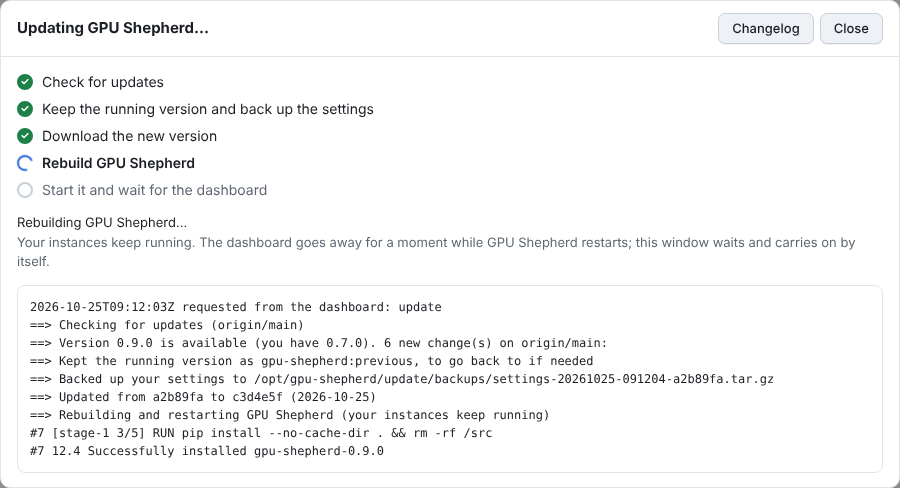

# Versions, changelog and updates

Every change merged into GPU Shepherd gets a version number and an entry in
[CHANGELOG.md](../CHANGELOG.md), so you can see what you are running, what is newer and what
changed. This page covers what you see in the dashboard and how versions are made.

## In the dashboard

- **The version** (for example `v0.8.0`) sits next to *GPU Shepherd* at the top of every page.
  Click it for the Updates window: the running version, the newest version, when GPU Shepherd last
  checked, and what is new.
- **Check for updates** asks the server whether a newer version is out. It is in the Updates
  window and in Settings > Updates. GPU Shepherd also checks once a day by itself.
- **What's new**: when an update is available, the Updates window and the notice on the dashboard
  list the changelog entries of every version newer than yours, before you install anything.
- **Changelog** (in the Updates window and in Settings) lists every version and what changed in it.
  Your version is marked *running*, versions you can update to are marked *new*.
- **Progress**: while a check or an update runs, the Updates window shows each step as it happens
  and the last lines of the updater's output:
  1. Check for updates
  2. Keep the running version and back up the settings
  3. Download the new version
  4. Rebuild GPU Shepherd
  5. Start it and wait for the dashboard

  

  The dashboard goes away for a moment while GPU Shepherd restarts; the window keeps trying quietly
  and carries on by itself when it is back. When the update is done it says so, with a **Reload**
  button so the page uses the new version's screens. If a step fails it is marked, and if the
  updater had to go back to the previous version, that shows as an extra step.

Checking and updating from the dashboard need the small update service on the host (the guided
installer offers it, or run `sudo ./update.sh --enable-dashboard-updates` once). GPU Shepherd runs
in a container and can't update itself from inside it. Without the service, the dashboard still
shows your version and the changelog, and tells you which command to run. From a terminal,
`sudo ./update.sh` shows the same version and changes, and `--check` only looks.

## Versions and releases

Versions look like `MAJOR.MINOR.PATCH`. The number lives in `gpushepherd/__init__.py`, and the
newest section of `CHANGELOG.md` always matches it (a test checks this).

When a pull request is merged into `main`, the [Release workflow](../.github/workflows/release.yml)
runs [`scripts/release.py`](../scripts/release.py), which:

1. picks the next version from the pull request's labels:

   | Label | Example | Use it for |
   |---|---|---|
   | `major` | 0.8.0 → 1.0.0 | changes that work differently or need something from you after updating |
   | *(none)* or `minor` | 0.8.0 → 0.9.0 | new features and improvements (the default) |
   | `patch` | 0.8.0 → 0.8.1 | fixes and small changes |
   | `no release` | | no new version (for example a typo in a comment) |

2. adds a section for it to the top of `CHANGELOG.md`. The entries are the bullet points under a
   `## Changelog` heading in the pull request's description, or its title when there is none.
   Write them for people who use GPU Shepherd: what they will notice, not how it was done.
3. commits both files to `main` as *Release X.Y.Z*, tags it `vX.Y.Z` and publishes a GitHub
   release with the same notes.

So a pull request never edits the version or the changelog itself, and two open pull requests
never conflict over them. Commits pushed straight to `main` get a patch release named after the
commit. The workflow needs permission to push to `main`: if you protect the branch, allow GitHub
Actions to bypass the rule. Labels that don't exist yet can be created from the pull request's
Labels menu.

## How the dashboard learns about versions

`update.sh` on the host does the checking (the container never runs git). Each time it checks or
updates, it writes `<data folder>/update/status.json` with, among other things:

| Key | Meaning |
|---|---|
| `state` | `idle`, `checking`, `updating`, `done` or `failed` |
| `step` | `check`, `backup`, `download`, `rebuild`, `start` or `recover`: what it is doing, or what failed |
| `version` | the version of the code in the clone |
| `latest_version` | the version of the newest code on the remote |
| `behind`, `commits` | how many commits are new, and their subjects |

It also saves the newest `CHANGELOG.md` from the remote as `<data folder>/update/changelog.md`,
which is how the dashboard can list what a version brings before it is installed. The changelog of
the running version is built into the image. A check or update that reports nothing for 30 minutes
is treated as stopped, so a crashed updater never leaves the dashboard waiting forever.
